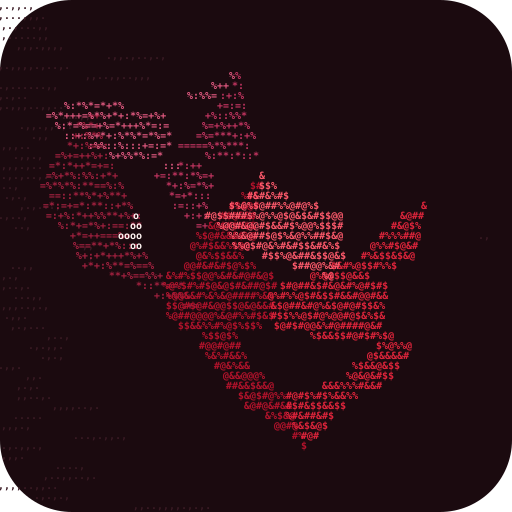

<div align="center">



# Aha

**A Discord bot for reminders, TV episode alerts, YouTube voice playback and small everyday tools.**
Slash commands only, no privileged intents, and built to scale out across shards and pods.

[![CI][ci-badge]][ci]
[![Security][security-badge]][security]
[![Quality Gate][sq-gate-badge]][sonar]
[![Coverage][sq-coverage-badge]][sonar]
[![Mutation testing: mutmut][mutmut-badge]][mutmut]
[![mypy: strict][mypy-badge]][mypy]

[![Python 3.14][python-badge]][python]
[![discord.py][discordpy-badge]][discordpy]
[![Docker][docker-badge]][dockerfile]
[![License: MIT][license-badge]][license]
[![Last commit][last-commit-badge]][commits]
[![Open issues][issues-badge]][issues]

[Features](#features) ·
[Quickstart](#quickstart) ·
[Commands](docs/commands.md) ·
[Configuration](docs/configuration.md) ·
[Operating](docs/operations.md) ·
[Contributing](CONTRIBUTING.md)

</div>

## Features

| | |
|---|---|
| **Voice playback** | `/play` a YouTube link, then `/queue`, `/skip`, `/pause`, `/resume`, `/stop`, `/remove` and `/nowplaying`, with buttons on the now-playing message. Audio runs on a [Lavalink](https://github.com/lavalink-devs/Lavalink) node; the queue lives in PostgreSQL and survives restarts. The bot leaves after `VOICE_IDLE_MINUTES` of silence, a pause or an empty channel. |
| **Reminders** | `/remind`, `/reminders`, `/unremind`: durable, delivered by whichever pod is up, by ping or DM. |
| **TV episode alerts** | `/watch` a show and get told when each new episode airs (schedules from TVmaze). `/watching`, `/unwatch`. |
| **Summaries** | `/summarize` and a message menu, powered by Claude. Off per server until an admin turns it on. |
| **Everyday tools** | `/poll` (native Discord polls), `/roll`, `/coin`, `/8ball`, `/countdown`, `/time`, `/url` link previews, and a reaction counter. |
| **Per-server settings** | `/config` and `/configure`, stored in PostgreSQL. English and German. |
| **Privacy built in** | `/forgetme` deletes your data. Every table is declared in a data inventory that a test enforces; see [privacy](docs/privacy.md). |

Every command is listed with its options, cooldowns and permissions in the
[command reference](docs/commands.md), which is generated from the bot itself.

### Built to run in production

- **Scales out.** Shard groups per pod, PostgreSQL for shared state and a durable job scheduler that
  any pod can run ([ADR 0001](docs/adr/0001-runtime-architecture.md), [sharding](docs/sharding.md),
  [scheduler](docs/scheduler.md)).
- **Observable.** `/livez`, `/readyz` and Prometheus `/metrics` on every process, JSON logs with
  per-command context, and [alert rules](deploy/alerts/aha.rules.yml).
- **Minimal Discord footprint.** No message content, member or presence intents, and no message
  cache. The bot subscribes to only the `guilds` and `voice_states` events.
- **Safe by default.** Untrusted text is neutralised before it is shown, outbound fetches are
  SSRF-safe, replies never ping, and secrets are masked in logs.
- **Rigorously tested.** Strict mypy, a 95% coverage floor (currently 100%), and a mutation-testing
  gate on every pull request.

## Quickstart

You need [uv](https://docs.astral.sh/uv/getting-started/installation/) (it installs Python 3.14 for
you) and a bot token from the [Developer Portal](https://discord.com/developers/applications).

```bash
git clone https://github.com/aomarai/Aha.git && cd Aha
cp .env.example .env          # add your DISCORD_BOT_TOKEN
uv sync                       # installs dependencies (and Python 3.14)
uv run aha                    # or: uv run python -m aha
```

Invite the bot to a server (replace `APP_ID` with your application ID). The `permissions` value
grants View Channel, Send Messages, Embed Links and Read Message History:

```
https://discord.com/oauth2/authorize?client_id=APP_ID&scope=bot+applications.commands&permissions=84992
```

Check it is alive with `/ping`. For instant command updates while developing, set `DEV_GUILD_ID` to
your test server's ID.

### Optional services

The core commands need nothing else. Each extra switches on with one setting:

| To get | Set | Details |
|---|---|---|
| Reminders, show alerts, settings, the voice queue | `DATABASE_URL` | [Postgres runbook](docs/runbooks/postgres.md), [migrations](docs/migrations.md) |
| Voice playback | `LAVALINK_URL` and `LAVALINK_PASSWORD` | [Voice runbook](docs/runbooks/voice.md), [ADR 0002](docs/adr/0002-voice-playback.md) |
| `/summarize` | `ANTHROPIC_API_KEY` | an admin then runs `/configure summaries on` |

All settings are in the [configuration reference](docs/configuration.md).

## Running it for real

- **Commands are synced as a deploy step**, not at startup: run `uv run aha sync` once per release,
  after the new revision is serving. See [operating Aha](docs/operations.md#slash-command-syncing).
- **Releases** publish a versioned image to `ghcr.io/aomarai/aha`; deploy by digest, not by tag.
  See [releasing](docs/releasing.md) and the [changelog](CHANGELOG.md).
- **Health and metrics**, structured logs and gateway connection handling are described in
  [operating Aha](docs/operations.md).

## Documentation

| Topic | Where |
|---|---|
| Commands | [Command reference](docs/commands.md) |
| Configuration | [Environment variables](docs/configuration.md) |
| Operations | [Intents, sync, health, metrics, logging](docs/operations.md), [runbooks](docs/runbooks/) |
| Design | [Architecture decisions](docs/adr/), [sharding](docs/sharding.md), [scheduler](docs/scheduler.md), [components](docs/components.md), [i18n](docs/i18n.md) |
| HTTP API | [OpenAPI 3.1](docs/openapi.yaml) for the probe and metrics endpoints |
| Data and legal | [Privacy](docs/privacy.md), [terms](docs/terms.md) |
| Releases | [Releasing](docs/releasing.md), [changelog](CHANGELOG.md) |

## Development

```bash
uv sync                       # runtime and dev dependencies
uv run ruff check .           # lint
uv run ruff format .          # format
uv run mypy                   # type check (strict)
uv run pytest                 # tests (95% coverage floor)
uv run pre-commit install     # optional: run the hooks on every commit
```

CI runs lint, format, the pre-commit hooks, type checking, tests, a mutation-testing gate (pull
requests re-test only what they change), a Docker build with a smoke test and a Trivy scan, CodeQL
and dependency audits. Pull requests are reviewed by [Sourcery](https://sourcery.ai/). SonarQube
gates `main` only, as an advisory check. The workflows are in `.github/workflows/`.

A [dev container](.devcontainer/) (VS Code or the Dev Containers CLI) provides the same toolchain
with nothing installed on your machine. See [CONTRIBUTING.md](CONTRIBUTING.md) for the workflow and
the quality gates, and [AGENTS.md](AGENTS.md) for the full conventions.

### Project layout

```
src/aha/
├── bot.py, __main__.py   # the bot, and the entry point (`aha`, `aha sync`, `aha migrate`)
├── cogs/                 # command groups: voice, playback, remind, shows, polls, summarize, ...
├── voice.py, playback.py # audio backend (Lavalink) and the queue logic
├── scheduler.py          # durable job scheduler any pod can run
├── db.py, dbmigrate.py   # PostgreSQL pool and the plain-SQL migration runner
├── migrations/           # NNNN_description.sql
├── locales/              # en-US and de strings
├── health.py, metrics.py # /livez, /readyz, /metrics
└── net.py, textutil.py   # SSRF-safe fetching, untrusted-text handling
docs/                     # reference, ADRs, runbooks     tests/    # pytest suite
scripts/                  # CI gates and generators       deploy/   # alert rules
```

## Privacy

Aha stores only what its features need: your reminders, your show subscriptions, queued tracks and
per-server settings, each with a stated owner and retention. Logs record who ran which command (IDs
and option names, never values). `/forgetme` deletes your data and `/privacy` links the
[privacy policy](docs/privacy.md) and [terms](docs/terms.md), which are drafts awaiting the owner's
review. Every new table must be declared in `aha.datainventory`; a test enforces it.

## Contributing

See [CONTRIBUTING.md](CONTRIBUTING.md), report vulnerabilities as described in
[SECURITY.md](SECURITY.md), and please follow the [Code of Conduct](CODE_OF_CONDUCT.md).

## License

MIT. See [LICENSE](LICENSE).

[ci]: https://github.com/aomarai/Aha/actions/workflows/ci.yml
[ci-badge]: https://github.com/aomarai/Aha/actions/workflows/ci.yml/badge.svg?branch=main
[security]: https://github.com/aomarai/Aha/actions/workflows/security.yml
[security-badge]: https://github.com/aomarai/Aha/actions/workflows/security.yml/badge.svg?branch=main
[sonar]: https://sq.homelab.local/dashboard?id=aomarai_Aha_b5802f94-d481-4d0f-99fc-841310f2f7c2
[sq-gate-badge]: https://sq.homelab.local/api/project_badges/measure?project=aomarai_Aha_b5802f94-d481-4d0f-99fc-841310f2f7c2&token=sqb_0372f73fdf3a98a173c869d0ad20370857ca068f&metric=alert_status
[sq-coverage-badge]: https://sq.homelab.local/api/project_badges/measure?project=aomarai_Aha_b5802f94-d481-4d0f-99fc-841310f2f7c2&token=sqb_0372f73fdf3a98a173c869d0ad20370857ca068f&metric=coverage
[python]: .python-version
[python-badge]: https://img.shields.io/badge/python-3.14-blue?logo=python&logoColor=white
[discordpy]: https://discordpy.readthedocs.io/
[discordpy-badge]: https://img.shields.io/badge/discord.py-%E2%89%A52.7-5865F2?logo=discord&logoColor=white
[dockerfile]: Dockerfile
[docker-badge]: https://img.shields.io/badge/docker-distroless-2496ED?logo=docker&logoColor=white
[license]: LICENSE
[license-badge]: https://img.shields.io/github/license/aomarai/Aha
[commits]: https://github.com/aomarai/Aha/commits/main
[last-commit-badge]: https://img.shields.io/github/last-commit/aomarai/Aha
[issues]: https://github.com/aomarai/Aha/issues
[issues-badge]: https://img.shields.io/github/issues/aomarai/Aha
[mypy]: https://mypy-lang.org/
[mypy-badge]: https://www.mypy-lang.org/static/mypy_badge.svg
[mutmut]: https://mutmut.readthedocs.io/
[mutmut-badge]: https://img.shields.io/badge/mutation%20testing-mutmut-blueviolet
